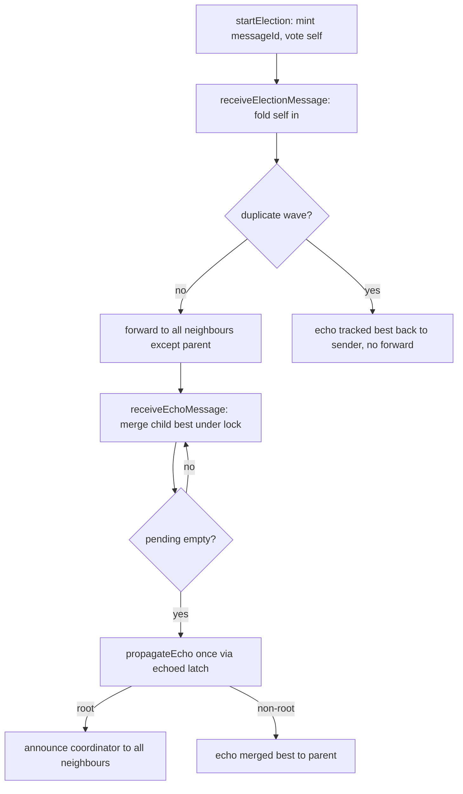

# Election Protocol

Echo-based flood over the `ElectionService` gRPC contract, across the neighbour
graph (`src/main/java/com/cs324/worker/WorkerRemoteImpl.java`,
`src/main/java/com/cs324/election/`).

The algorithm below is unchanged from the RMI version it replaces: same wave id
scheme, same winner rule, same duplicate handling, same announcement relay and
same five-job term. Only the wire changed.

## Transport

| Concern | Decision |
| --- | --- |
| Service | `ElectionService` (`election.proto`): `SendElection`, `SendEcho`, `AnnounceCoordinator`, each answering an empty ack. |
| Peer addressing | `RegistryService.GetWorkerAddress` supplies `host` and `grpc_port`. An RMI contact port can never receive HTTP/2, so no port is ever guessed. |
| Channels | One `ManagedChannel` per peer, cached in `GrpcElectionTransport` and resolved lazily. |
| Deadlines | `Constants.ELECTION_RPC_DEADLINE_MS` per hop, so one slow neighbour cannot hold the wave. |
| Failure | A failed hop reports `false`, exactly where a `RemoteException` used to land: drop the edge from `pendingChildren` and `handleDeadNeighbour`. |
| Cache invalidation | `UNAVAILABLE`, `INTERNAL`, `UNKNOWN` and `CANCELLED` evict the cached channel, because a peer may have restarted on a different port. `DEADLINE_EXCEEDED` keeps it: that peer is slow, not gone. |
| Fallback | `RmiElectionTransport` carries the wave when a worker has published no gRPC endpoint, which keeps the legacy tests and a pre-migration cluster working. |

`WorkerRemote.receiveElectionMessage`, `receiveEchoMessage` and
`receiveCoordinatorMessage` remain as thin adapters into the same algorithm, so
a cluster mid-migration and every existing election test still behave exactly as
before.

## Terms

`ElectionMessage`, `EchoMessage` and `CoordinatorAnnouncement` gained an additive
`term` field. A wave carries the term it belongs to, the root announces
`max(known term) + 1`, and a worker applies a term-bearing announcement only when
`(term, coordinator_id)` is not older than the pair it already holds, ties going
to the higher tuple. That is what stops a deposed coordinator from reclaiming a
term it has already lost.

A term-less announcement is the legacy RMI path and is applied unconditionally:
under the old contract a rotation to a *lower* worker id is legal, and ordering
those would silently break the five-job term.



1. **Propagation.** `startElection()` mints `messageId = (id << 32) | electionCounter`, votes `(self, JAC)`, sets `pendingChildren = all neighbours`, forwards via `receiveElectionMessage`. Each hop folds itself in, then forwards to every neighbour except the parent (`originId`); unreachable neighbours are removed from `pendingChildren` so they cannot stall the wave.
2. **Duplicates answered, never dropped.** Dedup guard is the `elections: Map<Long, ElectionState>` claimed atomically with `compute()` — `seenMessageIds` is audit-only. A repeat wave reads the tracked best under `synchronized` and calls `receiveEchoMessage` back to the sender, then returns without forwarding. Silence would stall the sender, which only retires a neighbour on its echo (triangle topology proves this: two nodes forward to each other and must answer or both wait forever).
3. **All reachable workers considered.** Echoes merge under `synchronized(election)` with the same winner rule; each child is crossed off `pendingChildren`. The wave completes only when the set empties, then `propagateEcho` fires exactly once per wave via the `echoed` latch. Non-root nodes relay upward; the root decides.
4. **Winner rule: lowest JAC wins, highest ID breaks ties.** Applied identically on forward (`receiveElectionMessage`) and on merge (`receiveEchoMessage`):
```java
if (currentJac < bestJac) { bestId = this.id; bestJac = currentJac; }
else if (currentJac == bestJac && this.id > bestId) { bestId = this.id; bestJac = currentJac; }
```
5. **Coordinator announced.** Root sets `currentCoordinatorId` through `acceptLeadership()` at term `max(known term) + 1`, uses `coordMessageId = messageId + 1000000` (never collides with a wave id), pre-records it in `seenCoordinatorMessageIds` before broadcasting, then calls `AnnounceCoordinator` on all neighbours. Announcements use a separate set from waves: first sighting is applied + relayed, repeats are dropped without relay so a cyclic broadcast terminates. A joiner uses `adoptCoordinator()` (local only, no relay) so adoption never reads as a new term.
6. **5-job term.** `Constants.JOBS_PER_TERM = 5`. `submitJob()` calls `reserveTermSlot()` (CAS increment, spend on accept not completion); over-budget or `handoverInProgress` jobs are refused with a retryable `RemoteException` and the job id is released for client retry. `maybeRotateCoordinator()` CAS-resets `5 -> 0`, sets `handoverInProgress`, and calls `startElection()` exactly once. The winner resets `termJobsCoordinated = 0` on announcement; through 4 jobs the leader is kept, on the 5th it rotates to the lowest-JAC worker.

## Verifying

```
mvn "-Dtest=GrpcElectionTest" test
mvn "-Dtest=WorkerElection*,WorkerEcho*,WorkerDispatch*,WorkerCoordinatorMessage*" test
```

`GrpcElectionTest` wires chain and triangle topologies over real TCP gRPC, then
**stops the RMI registry before the election runs**, so agreement can only be the
result of gRPC hops. It also asserts the winner rule, that a dead neighbour does
not stall the wave, and - through a server interceptor - that a duplicate wave is
answered with an echo instead of being forwarded again. The `WorkerElection*`
suites still cover the same protocol over the RMI fallback.
